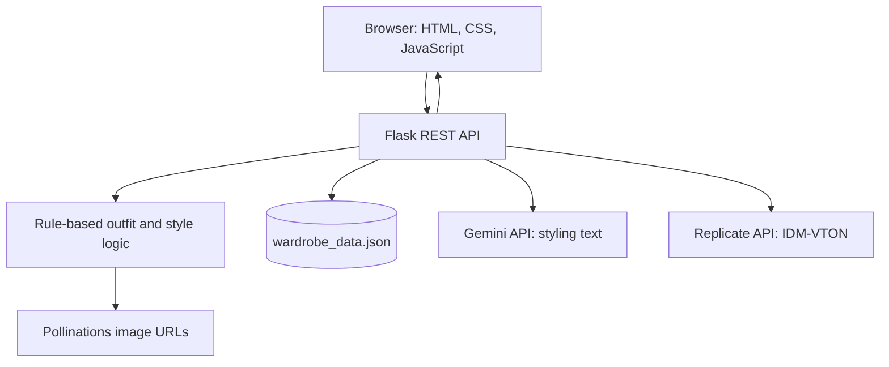

<div align="center">

# VOGUE.AI

### Fashion recommendations · AI-assisted styling · Virtual try-on

**A full-stack fashion exploration prototype combining a Flask API, rule-based styling, and integrations with hosted AI models.**

[](https://www.python.org/)
[](https://flask.palletsprojects.com/)
[](https://developer.mozilla.org/en-US/docs/Web/JavaScript)
[](#about-the-project)

[Features](#features) · [Architecture](#architecture) · [Getting started](#getting-started) · [API reference](#api-reference) · [Limitations](#known-limitations)

</div>

---

## About the project

**VOGUE.AI** explores how conventional web engineering can work with established AI services to support online fashion discovery. The application lets users explore curated outfit combinations, request AI-written styling guidance, upload person and garment images for model-assisted virtual try-on, analyse a set of stated style preferences, and maintain a simple digital wardrobe.

The application was developed as a **B.Tech Computer Science and Engineering (Artificial Intelligence) final-year project**. Its focus is *integrating* third-party AI capabilities into a web application—not training a new recommendation or image-generation model from scratch.

> **Project status:** Academic prototype. The repository contains the application implementation, but end-to-end operation of external services and deployment should be tested in the target environment. Do not treat this as a production-ready personal-image or wardrobe service.

## Features

| Module | What the current code does | Approach |
| --- | --- | --- |
| **Outfit recommendations** | Returns up to three outfit suggestions based on occasion, season, gender, style and colour preferences, with generated image URLs | Rule-based outfit catalogue + Pollinations image URL generation |
| **AI styling assistant** | Accepts a profile and prompts Gemini for free-form clothing and styling suggestions | Google Gemini API (`gemini-2.5-flash-lite`, fallback to `gemini-2.5-flash`) |
| **Virtual try-on** | Accepts a person image and a garment image and sends them to a hosted model | Replicate-hosted **IDM-VTON** |
| **Style analysis** | Returns a style personality, indicative score, colour insight, wardrobe essentials and tips | Deterministic lookup tables and rules, **not** a trained classifier |
| **Digital wardrobe** | Lists, adds and removes saved clothing entries | Local JSON-file storage |
| **Theme and interface** | Multiple dedicated pages with styling controls and responsive page layouts | HTML, CSS and JavaScript |

### A closer look at virtual try-on

The virtual try-on route accepts two uploaded images and calls a pretrained IDM-VTON model via Replicate. The model generates a result image that the backend returns to the browser. In the checked implementation, the request is configured for an **upper-body garment**, and the garment description is currently hardcoded; those constraints matter when interpreting the results.

`rembg` and Pillow are included among the project's dependencies, but background removal is **not currently invoked by the routes inspected**. The repository should not be described as implementing a verified background-removal pipeline until that functionality is connected and tested.

## Tech stack

| Layer | Technology |
| --- | --- |
| User interface | HTML5, CSS3, vanilla JavaScript |
| Backend and routing | Python 3.11, Flask, Flask-CORS |
| Generative text | Google Gemini via `google-genai` |
| Virtual try-on | Replicate API and pretrained IDM-VTON |
| Outfit imagery | Pollinations image URL service |
| Image dependencies | Pillow, NumPy and `rembg` (some imported utilities are not yet connected to the active routes) |
| Persistence | `wardrobe_data.json` |
| Deployment configuration | Gunicorn and `Procfile` |

## Architecture



The frontend communicates with Flask endpoints over HTTP. The backend handles requests, invokes its local rule-based functions or external services, and returns JSON responses. The wardrobe module reads and writes a JSON file in the project directory.

## Repository layout

```text
vogue-ai/
├── app.py                    # Flask server and API endpoints
├── index.html                # Landing page and Gemini styling form
├── script.js                 # Shared frontend interactions / homepage logic
├── style.css                 # Shared styles
├── wardrobe_data.json        # File-backed wardrobe entries
├── requirements.txt          # Python dependencies
├── runtime.txt               # Requested Python runtime
├── Procfile                  # Gunicorn startup command
├── pages/
│   ├── recommend.html        # Rule-based outfit suggestions
│   ├── tryon.html            # Image-upload virtual try-on UI
│   ├── analyse.html          # Style analysis UI
│   ├── wardrobe.html         # Saved outfit management
│   ├── about.html
│   ├── contact.html
│   └── signup.html
└── README.md
```

## Getting started

### Requirements

- **Python 3.11** (the version specified in `runtime.txt`)
- `pip` and a working internet connection for dependencies and external image/AI services
- An optional **Gemini API key** for AI-written styling suggestions
- A **Replicate API token** for model-backed try-on (Replicate usage may be billed)

### 1. Clone the repository

```bash
git clone https://github.com/Debasishsahoo17/vogue-ai.git
cd vogue-ai
```

### 2. Create a virtual environment

**macOS / Linux**

```bash
python3.11 -m venv .venv
source .venv/bin/activate
```

**Windows (PowerShell)**

```powershell
py -3.11 -m venv .venv
.venv\Scripts\Activate.ps1
```

### 3. Install dependencies

```bash
python -m pip install --upgrade pip
pip install -r requirements.txt
```

> The requirements file contains a large collection of pinned packages. Installation can be slower than for a minimal Flask app, and platform-specific dependency issues are possible.

### 4. Configure API credentials

Create a `.env` file at the project root when you want to use the external AI endpoints:

```dotenv
GEMINI_API_KEY=your_gemini_api_key_here
REPLICATE_API_TOKEN=your_replicate_api_token_here
```

The rule-based `/api/recommend` and `/api/analyse` routes do not need these credentials. The `/api/recommend-gemini` route needs Gemini configuration; `/api/tryon` needs a valid Replicate token and access to the configured model.

**Never commit the `.env` file or real credentials to a public repository.** Add `.env` and `.venv/` to your local `.gitignore` if necessary.

### 5. Run the application

```bash
python app.py
```

By default, the application starts on **port 8080**. Open:

**http://localhost:8080**

If you set `PORT` in your environment, use the specified port instead.

### Hosted deployment note

Several page scripts currently use:

```js
const API = 'http://localhost:8080';
```

That works for the default local environment, but **does not correctly address a remote hosted backend from another user's browser**. When Flask serves the frontend and API from the same origin, replace these hardcoded values in `pages/recommend.html`, `pages/tryon.html`, `pages/analyse.html`, and `pages/wardrobe.html` with:

```js
const API = window.location.origin;
```

Then redeploy. The included `Procfile` uses:

```text
web: gunicorn app:app --timeout 120 --workers 1
```

The Flask app serves the frontend and API from one process; deployment additionally requires the appropriate environment variables and a host capable of installing the Python dependencies. Local JSON-file writes may be temporary on hosts with ephemeral filesystems.

## API reference

| Method | Endpoint | Purpose |
| --- | --- | --- |
| `POST` | `/api/recommend` | Rule-based outfit suggestions and Pollinations image URLs |
| `POST` | `/api/recommend-gemini` | Gemini-generated styling text (API key required) |
| `POST` | `/api/tryon` | Model-based try-on; multipart form with `person` and `cloth` files |
| `POST` | `/api/analyse` | Rule-based style personality, score, and tips |
| `GET` | `/api/wardrobe` | List stored wardrobe entries |
| `POST` | `/api/wardrobe` | Add an entry to the wardrobe |
| `DELETE` | `/api/wardrobe/<item_id>` | Remove a stored entry |
| `POST` | `/api/generate-image` | Return a Pollinations URL for a provided prompt |

### Example: Request outfit ideas

```bash
curl -X POST http://localhost:8080/api/recommend \
  -H 'Content-Type: application/json' \
  -d '{
    "gender": "Female",
    "occasion": "Casual",
    "season": "Summer",
    "styles": ["Minimalist"],
    "color": "Neutral",
    "budget": "Medium"
  }'
```

The response contains a `success` flag and an `outfits` array with names, descriptions, tags and image URLs. The image URLs are generated by an external provider; the Flask server does not produce those images locally.

### Example: Request style analysis

```bash
curl -X POST http://localhost:8080/api/analyse \
  -H 'Content-Type: application/json' \
  -d '{
    "styles": ["Minimalist"],
    "colors": ["Neutral"],
    "bodyType": "Athletic",
    "occasion": "Office"
  }'
```

The returned score is an application-defined styling indicator, **not a validated prediction of fashion quality or a machine-learning confidence probability**.

### Example: Upload images for virtual try-on

```bash
curl -X POST http://localhost:8080/api/tryon \
  -F 'person=@person.jpg' \
  -F 'cloth=@garment.jpg'
```

This endpoint needs a valid Replicate token and access to its configured model. The API response contains `result_image` when successful.

## Known limitations

This academic prototype has several practical limitations that future development could address:

1. **Deployment URL configuration:** Some page scripts have a hardcoded localhost API address; update this for hosted usage.
2. **Single shared wardrobe:** JSON storage has no per-user authentication or access controls; do not put private data in a publicly writable instance.
3. **File-based persistence:** Concurrent writes and ephemeral hosting storage can cause data loss or inconsistencies.
4. **Model configuration:** Virtual try-on is currently upper-body oriented, with a fixed garment description; results may not match all clothing categories displayed by the UI.
5. **External dependencies:** Gemini, Replicate and Pollinations require network access and are subject to provider availability, credentials, limitations and possible fees.
6. **Unconnected image utilities:** Some imaging libraries are installed/imported but not wired into the currently active route logic.
7. **Evaluation:** No reproducible benchmark dataset, formal user study, automated test suite or independently verified accuracy results are provided in this repository.
8. **Security and privacy:** This should not be exposed as an unrestricted production service without authentication, input validation, request limits, safe data handling and explicit consideration of image privacy.

## Future improvements

- Add per-user accounts and a real database for wardrobes.
- Make API URLs environment-aware across all pages.
- Add input validation, request limits, error monitoring and automated tests.
- Make garment descriptions and categories configurable in the try-on pipeline.
- Integrate and test background removal where it demonstrably improves results.
- Evaluate outputs using a reproducible test methodology rather than unsupported accuracy claims.
- Document supported image formats, privacy practices and external API costs.

## Academic context and credits

**Project:** VOGUE.AI — AI-Based Fashion Recommendation and Virtual Try-On System  
**Programme:** B.Tech in Computer Science and Engineering (Artificial Intelligence)  
**Institution:** GIFT Autonomous, Bhubaneswar, India  
**Repository:** [Debasishsahoo17/vogue-ai](https://github.com/Debasishsahoo17/vogue-ai)

The application integrates third-party services and pretrained models; model architectures and services belong to their respective authors and providers. References for further reading:

- [Flask documentation](https://flask.palletsprojects.com/)
- [Replicate documentation](https://replicate.com/docs)
- [IDM-VTON research repository](https://github.com/yisol/IDM-VTON)
- [Google Gen AI Python SDK](https://github.com/googleapis/python-genai)
- [rembg repository](https://github.com/danielgatis/rembg)

---

<div align="center">

**Built as an academic exploration of full-stack development and practical AI integration.**

</div>
