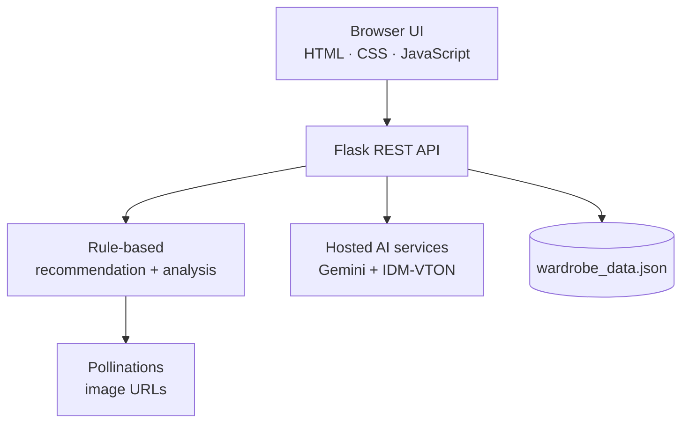

<div align="center">


# VOGUE.AI

### AI-assisted fashion discovery, personal styling, and virtual try-on

An academic full-stack prototype that combines a polished fashion interface, deterministic recommendation logic, and hosted generative-AI services.

[](https://www.python.org/)
[](https://flask.palletsprojects.com/)
[](https://developer.mozilla.org/docs/Web/JavaScript)
[](https://ai.google.dev/)
[](https://replicate.com/)
[](#project-status)

[Overview](#overview) · [Features](#features) · [Architecture](#architecture) · [Quick start](#quick-start) · [API](#api-reference) · [Limitations](#known-limitations)

</div>

---

## Overview

**VOGUE.AI** explores how a conventional web application can bring several fashion-assistance experiences into one place. A user can request occasion-aware outfit ideas, receive Gemini-written styling guidance, generate a model-assisted virtual try-on, analyse selected style preferences, and save looks to a lightweight digital wardrobe.

The project was built as a **B.Tech Computer Science and Engineering (Artificial Intelligence) final-year project**. Its purpose is to demonstrate practical AI-service integration and full-stack development—not to claim a newly trained fashion model.

> [!IMPORTANT]
> The recommendation catalogue and style analyser are rule-based. Virtual try-on uses a pretrained IDM-VTON model hosted on Replicate, while natural-language styling uses Google Gemini. The displayed style score is an application-defined indicator, not an ML confidence score or a scientifically validated rating.

## Features

| Experience | What the user provides | What the current implementation does |
| --- | --- | --- |
| **AI styling assistant** | Body type, gender, occasion, season, preferred styles, budget, and context | Builds a fashion-stylist prompt and requests a written recommendation from Gemini |
| **Outfit recommender** | Occasion, season, gender, style, colour, and budget preferences | Selects up to three catalogue outfits by occasion, season, and gender; applies style and colour to the description/image prompt; returns budget as metadata |
| **Virtual try-on** | A person image and a garment image | Sends both files to the Replicate-hosted IDM-VTON model and returns the generated result image |
| **Style analyser** | Selected styles, colours, body type, gender, and occasion | Uses deterministic mappings to return a fashion personality, indicative score, tips, trends, and essentials |
| **Digital wardrobe** | Recommended or manually entered outfit information | Lists, adds, filters, and removes entries stored in a local JSON file |
| **Responsive interface** | — | Provides dedicated pages, dark/light controls, upload previews, cards, loaders, and feedback states |

### Current virtual try-on scope

The backend currently configures IDM-VTON for an `upper_body` garment, uses one fixed garment description, requests one sample, and enables automatic cropping. The garment-type and size controls visible in the browser are not yet used by the backend model request.

## Architecture



The Flask application serves both the frontend and the JSON API. Local functions handle catalogue selection, style mappings, and wardrobe persistence; external providers handle generated styling text, virtual try-on, and recommendation imagery.

## Tech stack

| Layer | Technology |
| --- | --- |
| Frontend | HTML5, CSS3, vanilla JavaScript, Font Awesome |
| Backend | Python 3.11, Flask, Flask-CORS, Gunicorn |
| Styling text | Google Gemini via `google-genai` |
| Virtual try-on | Replicate API with pretrained IDM-VTON |
| Outfit imagery | Pollinations image URL service |
| Persistence | Local JSON file |
| Supporting image packages | Pillow, NumPy, OpenCV, `rembg` |

> `rembg`, Pillow, NumPy, and OpenCV are present in the environment, but the active Flask routes do not currently run a background-removal or local image-processing pipeline.

## Project structure

```text
vogue-ai/
├── assets/
│   └── vogue-ai-hero.png    # Original README artwork
├── pages/
│   ├── about.html
│   ├── analyse.html         # Rule-based style analysis UI
│   ├── contact.html
│   ├── recommend.html       # Outfit recommendation UI
│   ├── signup.html
│   ├── tryon.html           # Person + garment upload UI
│   └── wardrobe.html        # Wardrobe management UI
├── app.py                   # Flask server, API routes, and application logic
├── index.html               # Landing page and Gemini styling form
├── script.js                # Shared homepage interactions
├── style.css                # Shared landing-page styles
├── wardrobe_data.json       # File-backed wardrobe data
├── requirements.txt
├── runtime.txt
├── Procfile
└── README.md
```

## Quick start

### Prerequisites

- Python **3.11**
- `pip`
- Internet access for package installation and hosted services
- A Gemini API key for the homepage styling assistant
- A Replicate API token for virtual try-on

The rule-based recommendation, style-analysis, and local wardrobe routes do not need Gemini or Replicate credentials.

### 1. Clone the project

```bash
git clone https://github.com/Debasishsahoo17/vogue-ai.git
cd vogue-ai
```

### 2. Create a virtual environment

<details>
<summary><strong>macOS / Linux</strong></summary>

```bash
python3.11 -m venv .venv
source .venv/bin/activate
```

</details>

<details>
<summary><strong>Windows PowerShell</strong></summary>

```powershell
py -3.11 -m venv .venv
.venv\Scripts\Activate.ps1
```

</details>

### 3. Install dependencies

```bash
python -m pip install --upgrade pip
pip install -r requirements.txt
```

The pinned environment includes computer-vision packages, so installation can take longer than a minimal Flask project.

### 4. Configure hosted services

Create a `.env` file in the project root:

```dotenv
GEMINI_API_KEY=your_gemini_api_key
REPLICATE_API_TOKEN=your_replicate_api_token
```

Keep `.env` out of version control. Never commit real credentials to a public repository.

| Variable | Used by | Needed for |
| --- | --- | --- |
| `GEMINI_API_KEY` | `/api/recommend-gemini` | AI-written styling guidance |
| `REPLICATE_API_TOKEN` | `/api/tryon` | IDM-VTON virtual try-on |
| `PORT` | Flask / Gunicorn | Optional server-port override; defaults to `8080` |

### 5. Run locally

```bash
python app.py
```

Open [http://localhost:8080](http://localhost:8080).

## API reference

| Method | Endpoint | Request | Result |
| --- | --- | --- | --- |
| `POST` | `/api/recommend` | JSON preference profile | Up to three catalogue-based outfits with external image URLs |
| `POST` | `/api/recommend-gemini` | JSON preference profile | Gemini-generated styling text |
| `POST` | `/api/tryon` | Multipart fields `person` and `cloth` | Hosted model result image URL |
| `POST` | `/api/analyse` | JSON style profile | Personality, score, tips, palette insight, trends, and essentials |
| `GET` | `/api/wardrobe` | — | Stored wardrobe entries |
| `POST` | `/api/wardrobe` | JSON wardrobe item | Newly stored item |
| `DELETE` | `/api/wardrobe/<item_id>` | — | Deletion confirmation |
| `POST` | `/api/generate-image` | JSON field `prompt` | Pollinations image URL |

<details>
<summary><strong>Example: request outfit recommendations</strong></summary>

```bash
curl -X POST http://localhost:8080/api/recommend \
  -H "Content-Type: application/json" \
  -d '{
    "gender": "Female",
    "occasion": "Casual",
    "season": "Summer",
    "styles": ["Minimalist"],
    "color": "Neutral",
    "budget": "Medium"
  }'
```

</details>

<details>
<summary><strong>Example: request style analysis</strong></summary>

```bash
curl -X POST http://localhost:8080/api/analyse \
  -H "Content-Type: application/json" \
  -d '{
    "gender": "Male",
    "bodyType": "Athletic",
    "occasion": "Office",
    "styles": ["Minimalist"],
    "colors": ["Neutral"]
  }'
```

</details>

<details>
<summary><strong>Example: submit a virtual try-on</strong></summary>

```bash
curl -X POST http://localhost:8080/api/tryon \
  -F "person=@person.jpg" \
  -F "cloth=@garment.jpg"
```

</details>

## Deployment

The repository includes a Gunicorn `Procfile`:

```text
web: gunicorn app:app --timeout 120 --workers 1
```

The recommendation, try-on, analysis, and wardrobe pages currently define their API base as `http://localhost:8080`. For same-origin deployment, change those page-level constants to:

```js
const API = window.location.origin;
```

Also consider replacing JSON-file persistence before deployment: many hosting platforms use ephemeral filesystems, and concurrent writes are not safely coordinated by the current implementation.

## Project status

VOGUE.AI is an **academic prototype**, not a production service. The repository demonstrates the user flow and integration architecture, but it does not include a reproducible model benchmark, automated test suite, authentication system, production database, or formal privacy controls.

## Known limitations

- The wardrobe is shared, file-backed, and has no user-level authentication or access control.
- The sign-up and contact surfaces are frontend demonstrations; they are not connected to an account or messaging backend.
- Several pages have a localhost API base that must be changed for hosted deployment.
- Try-on is currently fixed to upper-body garments and a hardcoded garment description.
- The visible garment-type and size choices do not yet change the try-on request.
- External AI and image services can be unavailable, rate-limited, changed, or billed by their providers.
- Generated outfit images come from an external URL service; they are not generated by the Flask server itself.
- User-uploaded images are sent to a third-party model provider; production use requires explicit privacy, retention, consent, and security decisions.
- No automated tests or independently verified accuracy metrics are included.

## Roadmap

- [ ] Replace hardcoded API bases with environment-aware or same-origin configuration
- [ ] Add authenticated user accounts and per-user wardrobes
- [ ] Move persistence to a production database
- [ ] Pass garment category and description dynamically to the try-on model
- [ ] Validate file type, size, request rate, and user input
- [ ] Add unit, API, and browser-level tests
- [ ] Add explicit image-privacy and data-retention controls
- [ ] Evaluate recommendations and try-on outputs with a reproducible methodology

## Academic context

| | |
| --- | --- |
| **Project** | VOGUE.AI — AI-Based Fashion Recommendation and Virtual Try-On System |
| **Programme** | B.Tech in Computer Science and Engineering (Artificial Intelligence) |
| **Institution** | GIFT Autonomous, Bhubaneswar, India |
| **Repository** | [Debasishsahoo17/vogue-ai](https://github.com/Debasishsahoo17/vogue-ai) |

## Acknowledgements

This project integrates services and pretrained work maintained by their respective authors and providers:

- [Flask](https://flask.palletsprojects.com/)
- [Google Gen AI Python SDK](https://github.com/googleapis/python-genai)
- [Replicate](https://replicate.com/docs)
- [IDM-VTON](https://github.com/yisol/IDM-VTON)
- [Pollinations](https://pollinations.ai/)
- [rembg](https://github.com/danielgatis/rembg)

---

<div align="center">

Built as an academic exploration of practical AI integration and full-stack fashion technology.

</div>
